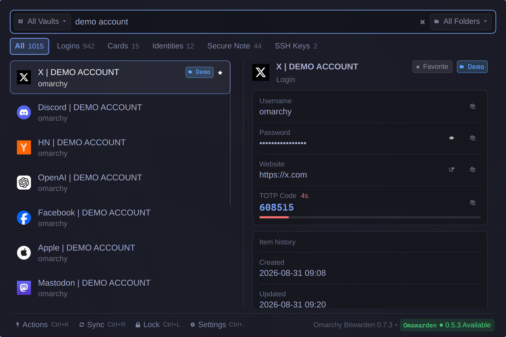
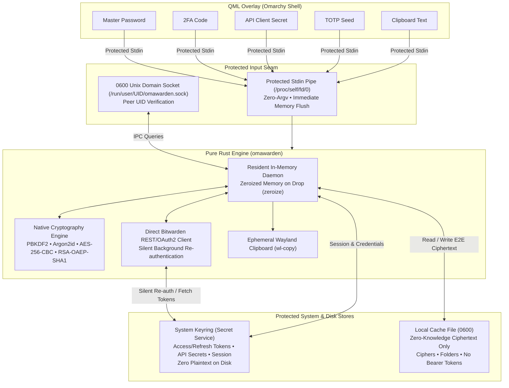

# omarchy-bitwarden

[](LICENSE)
[](https://www.rust-lang.org/)
[](https://github.com/omarchy)
[](README.zh-CN.md)

> A blazing fast, zero-bloat, and security-first Bitwarden / Vaultwarden overlay for **Omarchy Shell** on Hyprland.

Powered by a dedicated pure Rust engine (`omawarden`), `omarchy-bitwarden` delivers sub-millisecond credential lookups, minimal memory overhead, and rigorous process isolation—designed from the ground up to replace heavy Electron apps and sluggish Node CLI tooling with a native, Spotlight-style keyboard workflow.



---

## Why omarchy-bitwarden?

| Dimension                      | omarchy-bitwarden (`omawarden`)                                      | Official Desktop App (Electron)    | Official CLI (`bw`)                                                          |
| :----------------------------- | :------------------------------------------------------------------- | :--------------------------------- | :--------------------------------------------------------------------------- |
| **Response Latency**           | **Sub-millisecond** (resident in-memory IPC socket)                  | Slow UI render (1.5s - 3s)         | Heavy Node.js startup delay                                                  |
| **Memory Footprint**           | **Lightweight resident daemon (~5–15MB idle / ~64MB transient Argon2id peak)** | 500MB - 1GB+ Chromium bloat across multiple child processes | Transient, high peak memory (~80MB-120MB) |
| **Process Security**           | **Zero-leakage** (protected stdin & 0600 socket)                     | Broad webview memory exposure      | Secrets prone to `argv`/`ps` snooping                                        |
| **Token & Secret Storage**     | **System Keyring Isolation** (0 plaintext tokens in local cache)     | Desktop Keychain / Electron store  | Stored in plaintext cache file or relies on insecure, leak-prone `BW_SESSION` env export |
| **Local Data Caching**         | **Zero-Knowledge Ciphertext Cache** (fast offline search, no tokens) | Local cache file mixed with session tokens                         | Local cache file mixed with session tokens                                   |
| **Token Expiry Handling**      | **Master Password Unlock Only** (Keyring renews tokens silently; never forces API Key re-login)      | Desktop app preserves login; prompts for master password          | Hard 2-hr expiry (`Session expired`); forces manual CLI re-login            |
| **Lock-Screen Sync**           | **Native daemon auto-detection (Omarchy lock, Hyprlock, D-Bus/logind, sleep)** | App idle timeout only              | None (manual lock required)                                                  |
| **SSH Agent**                  | **Native OpenSSH Agent (`SSH_AUTH_SOCK`) with app-scoped approval cards** | Built into desktop app (eats ~1GB RAM) | None |
| **Secret Brokering & AI Agents** | **Native VaultBroker (`broker exec`, `.omawarden.toml`, MCP Server, streaming redaction, `--no-network`)** | None | None (requires dumping plaintext secrets or insecure environment variables) |
| **Mutual TLS (mTLS)**          | **Native client cert authentication (PKCS#12 / PEM)**                | Requires system proxy configuration | None |
| **Runtime Dependencies**       | **100% standalone binary** (Zero external deps)                      | Full Chromium/Node runtime         | Node.js environment required                                                 |

### Performance & Resource Benchmarks

| Tool / Component | Resident Memory (RSS) | Process Count | Search / Query Latency | Cold Start Latency | UI / Integration Type |
| :--- | :--- | :--- | :--- | :--- | :--- |
| **`omawarden` daemon + overlay** | **~5 – 15 MB** (idle base; ~64MB transient during Argon2id derivation) | **1 daemon** (+ ephemeral overlay) | **< 1 ms** (IPC socket) | **< 5 ms** | Hardware-accelerated Wayland QML |
| **`rbw` (Unofficial Rust CLI)** | ~5 – 10 MB | 1 daemon | < 5 ms (Unix socket) | < 5 ms | None (CLI terminal output only) |
| **Official Bitwarden Desktop** | ~500 MB – 1 GB+ | 8 – 12 processes (GPU, Webview, Utility, Crashpad) | 1.5s – 3s | 2s – 4s | Heavy Electron / Chromium Window |
| **Official CLI (`bw`)** | ~80 MB – 120 MB | 1 process per call | 300 ms – 800 ms | 300 ms – 800 ms | None (Node.js runtime boot per invocation) |

> [!NOTE]
> Why this matters: In tiling window managers like Hyprland, background utilities should not occupy hundreds of megabytes or gigabytes of memory just to serve SSH agent keys or look up credentials. `omawarden` stays dormant at **~5–15MB** RSS, responds to IPC queries under 1ms, and strictly zeroizes sensitive decrypted buffers upon completion or lock.

### Why omawarden instead of rbw?

`rbw` is an outstanding unofficial Rust CLI client in the Linux ecosystem that pioneered a zero-knowledge resident daemon architecture, serving as a major inspiration for `omawarden`. Both tools uphold high standards for cryptographic memory safety, featuring physical memory locking (`mlock`) and immediate memory zeroization (`zeroize`).

The difference between them is not "CLI vs Desktop", but rather **the distinct design trade-offs made across feature completeness, system dependencies, and workflows**:

#### Core Feature Comparison

| Dimension | `omawarden` (Native Engine & Standalone CLI) | `rbw` (Unofficial Rust CLI) |
| :--- | :--- | :--- |
| **Item Type Support Depth** | **First-Class 5 Types**: Dedicated extraction flags and structured UI inspection for Logins, Cards (CVV/number), Identities, Notes, and SSH Keys | Primarily targets password and TOTP; viewing cards/identities requires dumping unformatted raw JSON (`--raw`) |
| **OpenSSH Agent Capabilities** | **Vault-Backed Agent (`SSH_AUTH_SOCK`) + Key Generation**: Keys parsed only for single signature and zeroized; on-demand overlay unlock; per-app approval scoping (`first-use`), and interactive confirmation card with 600ms anti-misclick protection | **Agent Proxy**: Implements `SSH_AUTH_SOCK` to sign in-memory; lacks keypair generation, approval confirmation prompts, and per-app authorization scoping |
| **Mutual TLS (mTLS) Reverse Proxy** | **Native Support**: Authenticates to Vaultwarden/Bitwarden behind mTLS reverse proxies (PKCS#12 `.p12`/`.pfx` and PEM `.crt`/`.key`) with keyring-isolated passphrases | **Not supported** |
| **Password & Passphrase Generator** | **Dual Engine (GUI & CLI)**: Interactive `PasswordGeneratorModal.qml` with length/charset/entropy controls + Diceware word count/separators + `omawarden generate` with Wayland clipboard auto-clear guard | `rbw gen` CLI only (no GUI modal or Diceware passphrase support) |
| **Attachment Decryption** | **Native**: Downloads encrypted blobs and decrypts binary payloads via `AES-256-CBC` for preview/export | **Not supported** (see open feature request [doy/rbw#130](https://github.com/doy/rbw/issues/130)) |
| **Password Revision History** | **Native**: Decrypts and displays item password revision history | **Not supported** |
| **Organizations & Collections** | **Full Support**: `RSA-OAEP-SHA1` Org key unwrapping, Multi-Org & Collection filtering | **Basic Support**: Focused on personal vault; limited organization & collection support ([doy/rbw#351](https://github.com/doy/rbw/issues/351)) |
| **Lock Screen Security Integration** | **Active Zeroize on Lock**: Listens to Hyprlock, Omarchy lock, D-Bus `logind` sleep/lock signals | **Passive Idle Timeout**: Secrets remain in memory during sleep/lock if idle timer hasn't expired |
| **Authentication & Secret Storage** | **System Keyring (Secret Service) Integration**: Silent background token renewal without interrupting workflow | **GnuPG / pinentry Interaction**: Standard pinentry (supports TTY `pinentry-curses`); independent of desktop keyring |
| **GUI IPC Integration** | **Dedicated Structured JSON IPC Socket**: Designed for high-throughput, instant desktop overlay rendering (<1ms) | Plain text stdout/stderr intended for terminal pipelines |

#### Current Limitations of omawarden compared to rbw

In the following scenarios, `rbw` holds clear advantages, allowing users to choose the best fit for their workflow:
1. **Distribution Packaging & Maturity**: `rbw` is packaged in official repositories across Arch, Debian, Fedora, Alpine, NixOS, and macOS Homebrew for one-command installation. `omawarden` is primarily distributed via AUR and GitHub Releases, and is not yet in other official distribution repositories.
2. **Headless & Server Compatibility**: `rbw` paired with `pinentry-curses` works seamlessly in pure TTYs, servers, or minimal Docker containers without Secret Service daemons. `omawarden` relies on system Secret Service keyrings for secure token persistence.
3. **Interactive CLI Editing**: `rbw` provides `rbw edit` to open `$EDITOR` and modify vault items directly from the terminal. `omawarden` currently focuses on read, extract, copy, and generation workflows, and terminal-based vault item mutation is not yet supported (planned for future releases).

---

## Keyboard Shortcuts

| Shortcut                               | Description                                                               |
| :------------------------------------- | :------------------------------------------------------------------------ |
| <kbd>Enter</kbd>                       | Copy primary credential (Password / Card Number / Public Key)             |
| <kbd>Ctrl</kbd> + <kbd>Enter</kbd>     | Copy live TOTP code                                                       |
| <kbd>Ctrl</kbd> + <kbd>U</kbd>         | Copy username                                                             |
| <kbd>Ctrl</kbd> + <kbd>T</kbd>         | Toggle field / secret visibility (passwords, keys, card codes, etc.)      |
| <kbd>Ctrl</kbd> + <kbd>H</kbd>         | Open password history modal for the selected login item                   |
| <kbd>Ctrl</kbd> + <kbd>O</kbd>         | Open primary website URL in default browser                               |
| <kbd>Ctrl</kbd> + <kbd>K</kbd>         | Open Action Palette (Copy username, TOTP, PIN, Org Name, History, etc.)    |
| <kbd>Ctrl</kbd> + <kbd>G</kbd>         | Open built-in Password & Passphrase Generator                             |
| <kbd>Ctrl</kbd> + <kbd>,</kbd>         | Open / Toggle Settings configuration view                                 |
| <kbd>Ctrl</kbd> + <kbd>L</kbd>         | Manually lock the vault immediately                                       |
| <kbd>Ctrl</kbd> + <kbd>R</kbd>         | Trigger manual vault sync with Bitwarden server                           |
| <kbd>↓</kbd> / <kbd>↑</kbd>            | Navigate item list or action options (stops at boundaries)                |
| <kbd>Tab</kbd>                         | Switch category filters (All, Logins, Cards, Identities, Secure Note, SSH Keys) |
| <kbd>Alt</kbd> + <kbd>V</kbd>          | Switch or cycle Vault / Organization scope filter (All, Personal, Organizations) |
| <kbd>Alt</kbd> + <kbd>F</kbd>          | Switch or cycle Folder scope filter (All Folders, specific folder)         |
| <kbd>Esc</kbd>                         | Dismiss Action Palette, History modal, Settings, or hide overlay          |

---

## Prerequisites

Ensure the following tools are available on your system:

- **omawarden Engine**: High-performance Rust backend for Bitwarden (distributed via AUR or GitHub Releases)
- **Keyring / Secret Service**: `secret-tool` (`libsecret` package on Arch/Debian/Fedora)
- **Wayland Clipboard**: `wl-clipboard` (`wl-copy` / `wl-paste`)

> [!TIP]
> **One-Click Setup**: When opening Omarchy Bitwarden for the first time without prerequisites, an interactive **Dependency Check** view automatically appears, allowing you to install `omawarden-bin`, `libsecret`, and `wl-clipboard` with a single click via an Omarchy floating terminal popup.

---

## Installation & Setup

### 1. Install omawarden Engine (Arch Linux / AUR)

The native engine is officially distributed on AUR in two flavors:

- **`omawarden-bin`** (Recommended): Official pre-compiled release binary package.
- **`omawarden-git`**: Development VCS package built from the bleeding-edge `develop` branch.

```bash
# Install stable pre-compiled release (recommended)
paru -S omawarden-bin
# or
yay -S omawarden-bin

# Or install bleeding-edge development VCS package
paru -S omawarden-git
```

*(Non-Arch distributions can download pre-built binaries directly from [GitHub Releases](https://github.com/icyleaf/omarchy-bitwarden/releases) and place them in your `$PATH`).*

### 2. Install Plugin via Omarchy CLI

```bash
omarchy plugin add https://github.com/icyleaf/omarchy-bitwarden.git --enable
```

### 3. Bind Global Hotkey & Window Rule (in `~/.config/hypr/bindings.lua`)

```lua
-- ~/.config/hypr/bindings.lua
o.bind("SUPER + slash", "Omarchy Bitwarden", "omarchy-shell shell toggle icyleaf.bitwarden")

o.window({ class = "org.quickshell", title = "(Bitwarden)" }, {
  float = true,
  center = true,
  size = { 1152, 768 }
})
```

## Engine Source Badges & Updates

Omarchy Bitwarden seamlessly identifies and manages the active engine source in the **Settings** modal:

- **`[ AUR: omawarden-bin ]` / `[ AUR: omawarden-git ]`**: Active when installed via pacman/AUR. Offers channel-aware one-click update actions (`Update (AUR)`) that launch your terminal AUR helper (`paru` or `yay`).
- **`[ System ]`**: Active on non-Arch distributions when running a standalone pre-compiled binary located in your system `$PATH` (e.g. `/usr/local/bin/omawarden`).
- **Development Suppression**: Development builds (e.g. `0.8.0-dev` or VCS revisions from `omawarden-git`) automatically suppress standard release update notifications to prevent downgrade prompts.

## Update & Uninstall

- **Update Plugin**:

```bash
omarchy plugin update icyleaf.bitwarden
```

- **Uninstall Plugin**:

```bash
killall omawarden
omarchy plugin remove icyleaf.bitwarden
```

---

## Authentication Methods

`omarchy-bitwarden` supports two authentication methods for connecting to Bitwarden or self-hosted Vaultwarden instances:

### 1. Master Password Login (+ Comprehensive 2FA Support)

- **Default & Direct**: Enter your account email and Master Password directly in the overlay login form.
- **Comprehensive Two-Factor Authentication (2FA)**:
  - **Authenticator App (TOTP)** (*Provider 0*): Enter your 6-digit verification code from your authenticator app.
  - **Email Verification Code** (*Provider 1*): Automatically dispatches an email challenge code with resend capabilities.
  - **Hardware Security Key / WebAuthn / FIDO2** (*Provider 7*): Native hardware security key support (YubiKey, SoloKey, Nitrokey, passkeys). Visual prompt instructs you to touch the physical security key, with support for user presence, user verification, and optional PIN entry.
  - **Multi-Provider Switcher**: When multiple 2FA methods are active on your account (e.g. Security Key + Authenticator + Email), an interactive provider selector allows switching between methods on the fly, with smart default selection favoring hardware security keys.
- **New Device Verification**: Seamlessly detects and prompts for email OTP verification challenges when logging in from a newly recognized device.
- **Remember Email**: Optionally toggle "Remember Email" to prefill your login email address across sessions.

### 2. API Key Login (Personal API Key)

- **Official Bitwarden CLI Standard**: Recommended for headless environments or accounts with hardware key / Duo 2FA.
- **How to obtain**:
  1. Open the [Bitwarden Web Vault](https://vault.bitwarden.com) (or your self-hosted Vaultwarden instance).
  2. Navigate to **Settings** → **Security** → **Keys** tab.
  3. Click **View API Key** and enter your master password.
  4. Copy your `client_id` (e.g. `user.xxxxxxxx-xxxx-xxxx-xxxx-xxxxxxxxxxxx`) and `client_secret`.
- **In Omarchy Overlay**: Switch the login tab to **API Key**, paste your `client_id` and `client_secret`, and log in. Once authenticated, subsequent unlocks are completed via your Master Password.
- **Keyring Persistence & Silent Renewal**: Your `client_secret` is securely preserved in the system Keyring (never written to disk). When 2-hour access tokens expire, `omawarden` automatically and silently re-authenticates in the background without interrupting sync or kicking you back to re-login.

### 3. Mutual TLS (mTLS) Client Certificate Authentication

For self-hosted Vaultwarden or Bitwarden deployments protected behind reverse proxies with client certificate verification (mTLS, e.g., Cloudflare Access, NGINX, or Traefik):

- **Supported Formats**:
  - PKCS#12 bundle (`.p12` / `.pfx`)
  - PEM encoded client certificate (`.crt` / `.pem`) with separate private key (`.key`)
- **Keyring Passphrase Protection**: Passphrases for encrypted certificate files are stored in the system Keyring rather than in plaintext config.
- **CLI Configuration**:
  ```bash
  # Configure PKCS#12 bundle with passphrase from stdin
  echo "cert_passphrase" | omawarden config set \
    --client-cert ~/.config/certs/client.p12 \
    --client-cert-password-stdin

  # Configure PEM certificate with separate private key
  omawarden config set \
    --client-cert ~/.config/certs/client.crt \
    --client-key ~/.config/certs/client.key
  ```

---

## Security Architecture & Privacy Safeguards

`omarchy-bitwarden` is engineered with a strict **zero-trust, descriptor-isolated security model** to protect your credentials from process snooping, memory dumps, and environment leakage on Linux:



### Key Security Guarantees:

1. **Zero Command-Line (`argv`) Credential Leakage**: Master passwords, client secrets, 2FA codes, TOTP seeds, and clipboard text are **never passed as command-line arguments**. By delivering all sensitive data exclusively through protected `stdin` streams or `0600` Unix domain sockets, command line inspection reveals zero sensitive credentials.
2. **Zero Process Environment (`env`) Secret Spillage**: API client secrets, passwords, and live session tokens are never exported to process environment variables (`/proc/<pid>/environ`).
3. **Strict Owner-Only File & Socket Permissions (`0600`) & Peer UID Verification**: The local vault cache file, downloaded attachments, and daemon Unix socket (`/run/user/<UID>/omawarden.sock`) enforce strict `0600` permissions and kernel-level peer UID verification (`SO_PEERCRED`), isolating endpoints across user accounts. Note: processes running under the same OS user account share UID privileges; process-level sandboxing (e.g. Bubblewrap/Flatpak) is recommended for isolating local untrusted applications.
4. **Deterministic Master Key Zeroization (`zeroize`)**: All cryptographic keys (`SymmetricCryptoKey`), derived master keys, and intermediate crypto buffers implement `zeroize::ZeroizeOnDrop` to overwrite key memory with zeros upon drop. When the vault is locked, all decrypted vault records in daemon memory are immediately cleared and dropped.
5. **Native FreeDesktop Secret Service Keyring Lifecycle**: Bearer tokens (`access_token`, `refresh_token`), API key secrets (`client_secret`), and active session tokens are stored securely inside the system Keyring (GNOME Keyring / KWallet / KeePassXC) via D-Bus Secret Service protocols. **The local cache file is a pure zero-knowledge ciphertext store with zero plaintext bearer tokens or master passwords on disk**. Immediate session destruction occurs on lock (<kbd>Ctrl</kbd>+<kbd>L</kbd>), screen-lock events (`hyprlock`/`swaylock`), or idle timeout.
6. **Ephemeral Clipboard Auto-Clearing (30s TTL)**: When copying passwords, TOTP codes, card CVVs, or SSH private keys, sensitive values are piped directly to `wl-copy` without entering shell logs. A dedicated timer daemon automatically clears the Wayland clipboard after 30 seconds (configurable in Settings).
7. **Zero External Runtime Dependencies**: 100% pure Rust binary. No external Node.js, Python, or official `bw` CLI binary is required at runtime.

---

## Vault-Backed OpenSSH Agent

`omawarden` includes a native OpenSSH agent implementation that serves SSH keys directly from your encrypted vault over the standard OpenSSH agent protocol.

### Key Capabilities:
- **Zero Disk Keys**: Private keys stay encrypted in the vault and are parsed in memory strictly for the duration of a single signature, zeroized immediately afterwards.
- **Unlock on Demand**: When an SSH or Git client requests a key while the vault is locked, the daemon automatically summons the Omarchy overlay to prompt for your master password (waiting up to 60s).
- **Interactive Approval Prompts**:
  - `first-use` (default): Asks once per key, client binary, and launching application (e.g. your terminal or editor); remembered until logout.
  - `always`: Confirms every individual signature request.
  - `never`: Signs silently as long as the vault is unlocked.
- **Agent Forwarding Defense**: Forwarded requests (`session-bind@openssh.com`) are cryptographically verified and **always prompt for approval**, preventing compromised remote servers from silently using your keys.
- **Anti-Misclick Guard**: The approval card in Omarchy Shell ignores Enter and Allow for its first 600ms, preventing accidental approvals from stray keystrokes while typing in other windows.
- **Fallback Notifications**: When the shell overlay is unavailable, falls back to desktop notifications with Approve/Deny buttons.
- **No Idle Keep-Alive Leakage**: Listing keys (`ssh-add -l`) never refreshes the vault idle timer.

### Usage:
1. **Enable in Settings**:
   - Toggle **SSH Agent** in Settings (<kbd>Ctrl</kbd>+<kbd>,</kbd>), or run:
     ```bash
     omawarden config set --ssh-agent true --ssh-agent-confirm first-use
     ```
2. **Export Environment Variable**:
   Point `SSH_AUTH_SOCK` to the daemon's agent socket in `~/.bashrc`, `~/.zshrc`, or `~/.config/uwsm/env`:
   ```bash
   export SSH_AUTH_SOCK="$XDG_RUNTIME_DIR/omawarden-ssh-agent.sock"
   ```
   Or specify it in `~/.ssh/config`:
   ```ssh-config
   Host *
       IdentityAgent ~/.config/omawarden/ssh-agent.sock  # or $XDG_RUNTIME_DIR/omawarden-ssh-agent.sock
   ```
3. **Inspect & Manage via CLI**:
   ```bash
   # Check agent running status and socket location
   omawarden ssh-agent status

   # List pending signatures waiting for approval
   omawarden ssh-agent pending

   # Answer a prompt from the terminal
   omawarden ssh-agent reply <id> --allow
   omawarden ssh-agent reply <id> --deny
   ```

---

## Password & Passphrase Generator

Generate cryptographically secure passwords or EFF Diceware passphrases directly in the overlay (<kbd>Ctrl</kbd>+<kbd>G</kbd>) or via the CLI.

### Features:
- **Character Passwords**: Configurable length (5–128), uppercase, lowercase, numbers, special symbols, minimum digit/symbol counts, and visual ambiguity filtering (`0`, `O`, `1`, `l`, `I`).
- **Diceware Passphrases**: Word-based passphrases with configurable word count (3–20), custom separators (e.g., `-`, `_`, `.`), and word capitalization.
- **Instant Entropy Rating**: Real-time visual entropy score in bits (Weak, Fair, Good, Strong) in the overlay modal.
- **Clipboard Guard**: Direct copy to Wayland clipboard with automatic 30s auto-clearing TTL.

### CLI Usage:
```bash
# Generate a 24-character password and copy to clipboard
omawarden generate -l 24 -c

# Generate password avoiding ambiguous characters (0, O, 1, l)
omawarden generate -l 18 --avoid-ambiguous

# Generate a 5-word Diceware passphrase separated by dots
omawarden generate --passphrase -w 5 -s . --capitalize -c
```

---

## VaultBroker (Secret Brokering & AI Agent Execution)

AI coding assistants (Claude Code, Cursor, Windsurf, OpenClaw) and automated workflows frequently require API tokens, database connection strings, and cloud credentials. Conventionally, developers store these in plaintext `.env` files—creating critical security vulnerabilities where malicious prompts or background agents exfiltrate credentials via `cat .env` or tool calls.

The **VaultBroker** subsystem inside `omawarden` completely eliminates plaintext `.env` files by injecting credentials from your Bitwarden/Vaultwarden vault directly into child process environments in memory, enforcing real-time streaming output redaction, destination binding policies, and Linux network isolation.

### Key Capabilities:
- **Zero-Plaintext Invariant (Strict No-Read)**: Neither AI agents nor scripts can read or dump raw secret values. Omawarden exposes **no tool or command** that prints unmasked secrets.
- **Real-Time Streaming Output Redaction**: All subprocess `stdout` and `stderr` streams are filtered using a streaming Aho-Corasick automaton. Any occurrence of a resolved secret is scrubbed on-the-fly and replaced with `[REDACTED:VAULT_SECRET]`.
- **Destination Binding & Interactive Approval Cards**: Secret access is bound to authorized binary paths and arguments. Unbound commands trigger an Omarchy Wayland overlay approval card (with `allow-once`, `allow-always`, or `deny`).
- **Linux Network Namespace Jailing (`--no-network`)**: Executes local build/test tools inside an unshared, isolated network namespace (`CLONE_NEWNET`), physically preventing network socket communication and data exfiltration.
- **Provider Auto-Inference**: Automatically detects 50+ providers (OpenAI, Anthropic, Gemini, AWS, GitHub, Cloudflare, Stripe, Database, etc.) and injects their canonical environment variables (e.g. `OPENAI_API_KEY`, `GITHUB_TOKEN`).
- **Project Manifest (`.omawarden.toml`)**: Zero-secret project configuration file safe to commit to Git.
- **Native Model Context Protocol (MCP) Server**: Embedded stdio MCP server (`omawarden broker mcp`) offering `list_available_tokens` and `exec_with_token` tools for AI editors.

---

### CLI Usage:

#### 1. Execute with Injected Secrets (`omawarden broker exec`)

```bash
# Execute command using credentials declared in .omawarden.toml
omawarden broker exec -- pytest

# Inject specific vault cipher (auto-infers provider variables like OPENAI_API_KEY)
omawarden broker exec --item OpenAI -- python3 agent.py

# Inject explicit environment variable mappings
omawarden broker exec -e GITHUB_TOKEN=GitHub#token -e DB_URL=Database#url -- ./deploy.sh

# Run offline in an isolated Linux network namespace (blocks outbound sockets)
omawarden broker exec --no-network -- cargo test
```

#### 2. Migrate Legacy `.env` Files (`omawarden broker import`)

```bash
# Safe preview: scan .env* files, detect providers, and preview .omawarden.toml without modifying disk or vault
omawarden broker import --dry-run

# Import detected keys into Bitwarden vault, scaffold .omawarden.toml, and securely wipe plaintext files
omawarden broker import --yes

# Import into vault and preserve legacy .env files (automatically adds .env* to .gitignore)
omawarden broker import --no-wipe
```

> [!NOTE]
> **Secure Wiping**: When wiping files, `omawarden` overwrites disk bytes with zeros, invokes `sync_all()` to ensure kernel flush to physical media, zeroizes memory buffers, and deletes the file.

#### 3. Destination Whitelist & Authorization (`omawarden broker allow`)

```bash
# Authorize /usr/bin/pytest to access OpenAI secrets
omawarden broker allow OpenAI /usr/bin/pytest

# Authorize python3 script prefix
omawarden broker allow Database /usr/bin/python3 -m my_worker

# List pending approval prompts
omawarden broker pending

# Reply to an approval prompt from terminal
omawarden broker reply <id> --allow
omawarden broker reply <id> --always
omawarden broker reply <id> --deny
```

#### 4. Native Model Context Protocol (MCP) Server (`omawarden broker mcp`)

Run the stdio MCP server for AI coding assistants:

```bash
omawarden broker mcp
```

**Configure in Claude Code (`~/.claude.json` / Claude Desktop):**
```json
{
  "mcpServers": {
    "omawarden": {
      "command": "omawarden",
      "args": ["broker", "mcp"]
    }
  }
}
```

**Configure in Cursor (`~/.cursor/mcp.json`):**
```json
{
  "mcpServers": {
    "omawarden": {
      "command": "omawarden",
      "args": ["broker", "mcp"]
    }
  }
}
```

**Available MCP Tools:**
- `list_available_tokens`: Inspect credential and field names without exposing secret values.
- `exec_with_token`: Safely execute a command with secrets injected and streaming output redaction applied.

#### 5. Dynamic Agent Instructions (`omawarden broker skills`)

```bash
# Print agent skills guide in Markdown
omawarden broker skills

# Output guide and capability matrix in JSON
omawarden broker skills --json
```

---

### Project Manifest (`.omawarden.toml`)

Create `.omawarden.toml` in your project root to declare required secrets. This file contains **zero plaintext secrets** and is safe to commit to version control:

```toml
# Automatically inject credentials using provider auto-inference or custom fields
items = [
    "OpenAI",
    "Anthropic",
    "Database",
]

# Optional explicit environment variable mappings (VAR = "Item#Field" or VAR = "Item")
[env]
CUSTOM_API_TOKEN = "MyService#api_token"
DATABASE_URL = "Database#DATABASE_URL"
```

---

## Roadmap

### Phase 1: Completed (Fast Lookup & Core Security)

- [x] In-memory caching & sub-millisecond fuzzy search
- [x] Full Argon2id / PBKDF2 / AES-256-CBC / RSA-OAEP native decryption
- [x] Real-time live RFC 6238 TOTP token engine & visual countdown
- [x] Screen-lock auto-lock hook & FreeDesktop Secret Service Keyring integration
- [x] Multi-slot system Keyring credential persistence & silent background re-authentication
- [x] Ephemeral Wayland clipboard manager with 30s auto-clear TTL
- [x] Encrypted binary attachment downloads & inline previews (images & text)
- [x] SSH key management (Ed25519/RSA/ECDSA generation, file import & export)
- [x] Vault-backed OpenSSH agent with unlock-on-demand and approval prompts
- [x] Multi-dimensional vault (personal/organization) and folder scope filtering
- [x] Multi-organization & collection key unwrapping with badges
- [x] Action Palette (<kbd>Ctrl</kbd>+<kbd>K</kbd>) & password history viewer (<kbd>Ctrl</kbd>+<kbd>H</kbd>)
- [x] FIDO2 / WebAuthn passkey indicator & item creation/update history
- [x] Locked-state background sync (syncing encrypted ciphertext while vault is locked)
- [x] Self-hosted Vaultwarden & personal API key login support
- [x] Comprehensive 2FA support (Authenticator TOTP, Email verification, and native FIDO2 / WebAuthn hardware security keys)
- [x] Official Arch Linux AUR distribution (`omawarden-bin`, `omawarden-git`) with UI engine source badges
- [x] Channel-aware update management & floating terminal dependency installer
- [x] Persistent search state (remembers query, category, and selected item across window sessions)
- [x] Dual-channel structured logging & privacy-redacted diagnostics

### Phase 2: Completed (Secure Password & Passphrase Generator)

- [x] Cryptographically secure random password generation (length, charset options, ambiguity filters)
- [x] EFF Diceware passphrase generation with configurable word count and separators
- [x] Native `omawarden generate` CLI command with Clipboard Guard auto-clearing (`-c / --copy`)
- [x] Daemon IPC generation endpoint and structured response model
- [x] Overlay `PasswordGeneratorModal.qml` with interactive length/entropy controls and regeneration
- [x] Action Palette (<kbd>Ctrl</kbd>+<kbd>K</kbd>) global generator shortcuts

### Phase 3: Completed (Vault-Backed OpenSSH Agent Protocol Service)

- [x] Implement OpenSSH Agent protocol Unix domain socket (`SSH_AUTH_SOCK`)
- [x] In-memory private key signing without writing decrypted keys to disk
- [x] Unlock-on-demand and lock-state awareness (opens overlay or suspends when vault is locked)
- [x] Interactive approval card with 600ms anti-misclick guard & notify-send fallback
- [x] Scoped `first-use` authorization (key, binary, ancestor app) & agent forwarding defense
- [x] CLI commands (`omawarden ssh-agent status|pending|reply`)

### Phase 4: Completed (VaultBroker Subsystem & MCP Agent for Secret Brokering)

- [x] Subprocess secret injection via `omawarden broker exec` with deterministic in-memory `zeroize`
- [x] Real-time streaming Aho-Corasick output redaction on stdout and stderr (`[REDACTED:VAULT_SECRET]`)
- [x] Destination binding whitelist policy (`broker allow`) and interactive Wayland overlay approval cards
- [x] Project manifest (`.omawarden.toml`) with ancestor discovery and 50+ provider pattern auto-inference
- [x] Linux network namespace isolation via `--no-network` (`unshare(CLONE_NEWNET)`)
- [x] Legacy `.env` scanning, Bitwarden vault cipher creation, and secure zero-overwrite disk wiping (`omawarden broker import`)
- [x] Native Model Context Protocol (MCP) server (`omawarden broker mcp`) with strict No-Read invariant
- [x] Dynamic agent skills self-discovery guide (`omawarden broker skills [--json]`)

### Phase 5: Planned (Vault Item Creation)

- [ ] New item creation modal in Overlay (Login, Secure Note, Card, Identity)
- [ ] Client-side cipher payload encryption (AES-256-CBC / HMAC) using user master key
- [ ] Bitwarden REST API POST `/ciphers` creation integration with auto-session renewal
- [ ] Local zero-knowledge ciphertext cache synchronization upon creation
- [ ] Integration with Phase 2 password generator for inline credential creation

### Phase 6: Planned (Vault Item Mutation & Lifecycle)

- [ ] In-place item editing (updating login credentials, cards, notes, custom fields)
- [ ] Folder and organization collection reassignment
- [ ] Secure item deletion & soft-delete (Recycle Bin) management
- [ ] Client-side cipher update validation and server sync reconciliation

### Phase 7: Future (Desktop Automation & Biometrics)

- [ ] Wayland auto-type / auto-fill integration (e.g. via `ydotool` / `wtype`)
- [ ] Quick biometric / PAM / Fingerprint system unlock (ADR 0025)

---

## Contributing

We welcome contributions of all kinds! To ensure smooth collaboration and automated changelog generation, please follow our development workflow:

1. **Branch off `develop`**: The `main` branch is reserved for tagged releases. All active development (features, bug fixes, refactors) branches off `develop`:
   ```bash
   git checkout develop && git pull
   git checkout -b <type>/<short-description>
   # Types: feat/, fix/, chore/, refactor/, sec/
   ```
2. **Local Verification**: Ensure formatting, lints, and tests pass before committing:
   ```bash
   cd omawarden
   cargo fmt --check
   cargo clippy --all-targets --all-features -- -D warnings
   XDG_RUNTIME_DIR=/tmp cargo test
   ```
   *(Optional)* If you use [`mise`](https://mise.jdx.dev/), you can run `mise run build` or `mise run dev-deploy` for local testing.
3. **Conventional Commits**: Write clear commit messages following Conventional Commits (e.g., `feat(daemon): ...`, `fix(ui): ...`).
4. **Submit PR against `develop`**: Open your Pull Request targeting the `develop` branch.

For complete development details, please see [CONTRIBUTING.md](CONTRIBUTING.md).

---

## Credits

`omarchy-bitwarden` is built upon the great foundation and inspirations of the open-source community:

- **[Bitwarden CLI (`bw`)](https://github.com/bitwarden/clients)**: Gratitude to the official Bitwarden team for their protocol specifications, API designs, and comprehensive reference client.
- **[rbw](https://github.com/doy/rbw)**: Tremendous appreciation to `rbw` for pioneering a lightning-fast, zero-knowledge resident Rust daemon architecture, which served as a major inspiration for `omawarden`.

---

## License

This project is open-sourced under the [MIT License](LICENSE).
