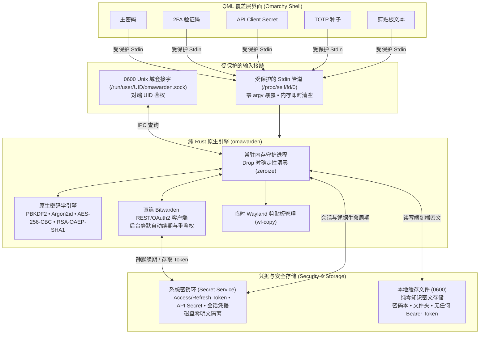

# omarchy-bitwarden

[](LICENSE)
[](https://www.rust-lang.org/)
[](https://github.com/omarchy)
[](README.md)

> 专为 Wayland & Hyprland 上的 **Omarchy Shell** 打造的极速、轻量、安全优先的 Bitwarden / Vaultwarden 覆盖层插件。

基于纯 Rust 原生引擎（`omawarden`），`omarchy-bitwarden` 提供亚毫秒级的凭据检索响应、极低的内存开销与严苛的进程隔离设计——旨在彻底替代臃肿的 Electron 桌面客户端与响应迟缓的 Node CLI 工具，为你带来原生的 Spotlight 式全键盘交互体验。


---

## 为什么选择 omarchy-bitwarden？

| 评估维度             | omarchy-bitwarden (`omawarden`)                         | 官方桌面端 (Electron)          | 官方命令行 (`bw`)                                            |
| :------------------- | :------------------------------------------------------ | :----------------------------- | :----------------------------------------------------------- |
| **响应延迟**         | **亚毫秒级**（常驻内存 IPC 套接字）                     | 界面渲染较慢（1.5 秒 - 3 秒）  | 较重的 Node.js 启动延迟                                      |
| **内存开销**         | **轻量常驻守护进程（静止常驻 ~5–15MB / 登录 Argon2id 计算峰值 ~64MB 瞬时）** | 500MB - 1GB+（8-12 个 Chromium/Electron 子进程） | 瞬时高内存峰值（~80MB-120MB） |
| **进程安全**         | **零泄漏**（受保护的 stdin 与 0600 套接字管道）         | 广泛的 Webview 内存暴露        | 易受到 `argv`/`ps` 进程窥探                                  |
| **Token 与凭据存储** | **系统密钥环安全隔离**（本地缓存文件零明文 Token）     | 平台 Keychain / Electron 存储  | 曾默认明文写入本地缓存文件，或依赖不安全且易泄漏的 `BW_SESSION` 环境变量 |
| **本地数据缓存**     | **纯零知识密文缓存**（离线毫秒级检索，无解密凭据）      | 本地缓存文件与认证凭据混杂                          | 本地缓存文件与认证凭据混杂                                     |
| **Token 到期处理**   | **仅需主密码解锁，免重复登录**（后台静默续期 Token，无需频繁重输 API Key） | 桌面端支持记住登录，主要依赖主密码解锁 | 2 小时 Token 硬过期报 `Session expired`，需频繁手动重新登录 |
| **锁屏联动**         | **守护进程原生自动检测（Omarchy 锁屏、Hyprlock、D-Bus/logind 睡眠与挂起）** | 仅依赖应用内闲置超时           | 无（需手动执行锁定）                                         |
| **SSH Agent**        | **原生 OpenSSH Agent（`SSH_AUTH_SOCK`），带按调用程序作用域审批** | 桌面端内置（吃掉近 1GB 内存） | 无 |
| **双向 TLS (mTLS)**  | **原生支持客户端证书认证（PKCS#12 / PEM）**              | 需配置复杂系统反向代理代理 | 无 |
| **运行时依赖**       | **100% 独立二进制**（零外部运行时依赖）                 | 完整的 Chromium/Node 运行环境  | 需要 Node.js 环境                                            |

### 性能基准测试与资源占用

| 客户端 / 工具组件 | 常驻内存 (RSS) | 运行进程数 | 检索 / IPC 响应延迟 | 冷启动耗时 | 交互界面 / 集成形式 |
| :--- | :--- | :--- | :--- | :--- | :--- |
| **`omawarden` 守护进程 + 覆盖层** | **~5 – 15 MB**（静止常驻；Argon2id 密钥派生时约 64MB 瞬时计算峰值） | **1 个守护进程**（覆盖层按需唤起） | **< 1 ms**（IPC 本地套接字） | **< 5 ms** | 硬件加速 Wayland QML |
| **`rbw`（非官方 Rust CLI）** | ~5 – 10 MB | 1 个守护进程 | < 5 ms（Unix 套接字） | < 5 ms | 无（纯终端命令行输出） |
| **官方桌面端 (Bitwarden Electron)** | ~500 MB – 1 GB+ | 8 – 12 个进程（GPU、Webview、Utility、Crashpad） | 1.5s – 3s | 2s – 4s | 繁重的 Electron / Chromium 窗口 |
| **官方 CLI (`bw`)** | ~80 MB – 120 MB | 每次调用独立进程 | 300 ms – 800 ms | 300 ms – 800 ms | 无（每次调用均有 Node.js V8 启动开销） |

> [!NOTE]
> 为什么资源占用对平铺窗口管理器（如 Hyprland）如此关键：作为日常必备的基础工具，后台组件不应仅仅为了提供 SSH Agent 密钥签名或快速查找密码而让一个吃掉近 1GB 内存的 Electron 桌面客户端常驻。`omawarden` 静止常驻仅需 **~5–15MB**，IPC 响应在 1 毫秒以内，并在锁定时或使用完毕后立即对内存敏感凭据进行零化覆写。

### 为什么自研 omawarden 而非直接采用 rbw？

`rbw` 是 Linux 生态中极其优秀的非官方 Rust 命令行客户端，开创了零知识常驻守护进程架构，为 `omawarden` 提供了重要启发。两者在内存安全上有着共同的高标准，均实现了物理内存锁定（`mlock`）与退出即时清零（`zeroize`）。

两者的差异并非“命令行 vs 桌面”，而是**面对同样的 Bitwarden 服务，在功能完整度、系统依赖与工作流上做出了不同的设计取舍**：

#### 核心特性对比

| 评估维度 | `omawarden`（原生引擎 & 独立 CLI） | `rbw`（非官方 Rust 命令行） |
| :--- | :--- | :--- |
| **条目类型支持深度** | **五大类型一等公民支持**：为登录、银行卡（CVV/卡号）、身份、便签及 SSH 密钥提供专用提取命令与结构化展示 | 主要面向登录密码与 TOTP；查看银行卡/身份等条目需使用 `--raw` 输出原始 JSON 自行提取 |
| **OpenSSH Agent 能力** | **保险库密钥代理 (`SSH_AUTH_SOCK`) + 密钥对生成**：私钥仅在执行单次签名时在内存中临时解析并立即覆写清零；按需唤起解锁；按程序隔离作用域（`first-use`），带 600ms 防误触延迟的交互式审批卡片 | **Agent 代理**：实现 `SSH_AUTH_SOCK` 协议，仅支持内存签名；不支持本地生成密钥对，不支持签名审批确认与调用程序作用域隔离 |
| **双向 TLS (mTLS) 反向代理** | **完整支持**：原生支持连接配置了 mTLS 客户端证书验证的自建 Vaultwarden / Bitwarden 实例（支持 PKCS#12 `.p12`/`.pfx` 及 PEM `.crt`/`.key`），证书密码隔离保存在系统密钥环中 | **不支持** |
| **密码与密语生成器** | **双引擎支持（GUI & CLI）**：交互式 `PasswordGeneratorModal.qml` 提供长度/字符集/熵值评级 + Diceware 词数/分隔符配置，CLI 命令 `omawarden generate` 配合 Wayland 剪贴板阅后即焚防泄漏保护 | 仅支持 `rbw gen` 命令行（无图形界面，不支持 Diceware 密语生成） |
| **加密附件处理** | **原生支持**：支持下载加密 Blob 并解密预览/导出 | **不支持**（参见长期未决 Issue [doy/rbw#130](https://github.com/doy/rbw/issues/130)) |
| **密码历史记录** | **原生支持**：可解密并查看条目历史修改过的旧密码 | **不支持**查看历史密码 |
| **多组织与集合** | **完整支持**：`RSA-OAEP-SHA1` 组织密钥解包，支持多组织与集合过滤 | **基础支持**：以个人密码库为主，多组织与集合管理较弱（参见 [doy/rbw#351](https://github.com/doy/rbw/issues/351)) |
| **锁屏安全联动** | **主动监听系统锁屏与睡眠**：电脑合盖或锁屏（Hyprlock/Omarchy/D-Bus）瞬时抹除内存凭据并锁定 | **被动闲置超时倒计时**：合盖休眠期间若未超时，凭据依然驻留内存 |
| **身份交互与凭据存储** | **系统密钥环（Keyring）深度集成**：后台无感静默刷新 Token，日常使用免频繁弹窗 | **GnuPG / pinentry 交互**：依靠系统的 pinentry（支持纯终端 `pinentry-curses`），不依赖桌面密钥环 |
| **图形界面 IPC 对接** | **专用结构化 JSON IPC 套接字**：专为桌面 Overlay 瞬时全量吞吐设计 | 纯文本标准输入输出，专为终端管道设计 |

#### omawarden 目前相比 rbw 的不足之处

在以下场景中，`rbw` 具有明显优势，读者可根据自身需求合理选型：
1. **发行版生态与打包成熟度**：`rbw` 已经进入 Arch、Debian、Fedora、Alpine、NixOS 等各大主流发行版的官方源，一行命令即可全局安装；`omawarden` 目前主要通过 AUR 和 GitHub 发布，尚未被各主流发行版官方源收录。
2. **纯无头环境（Headless / Server）兼容性**：`rbw` 配合 `pinentry-curses` 在纯字符终端、服务器或没有 Secret Service 密钥环服务的极简容器中开箱即用；`omawarden` 强依赖桌面 Secret Service 密钥环服务实现安全存储。
3. **终端内交互式条目编辑**：`rbw` 提供 `rbw edit` 等命令可随时唤起终端编辑器修改密码库；`omawarden` 目前主要聚焦于检索、提取、复制与生成流程，在终端内直接编辑写回远端的功能暂未支持（已列入后续规划）。

---

## 常用快捷键

| 快捷键                                 | 功能说明                                                   |
| :------------------------------------- | :--------------------------------------------------------- |
| <kbd>Enter</kbd>                       | 复制主要凭据（密码 / 卡号 / SSH 公钥）                     |
| <kbd>Ctrl</kbd> + <kbd>Enter</kbd>     | 复制实时 TOTP 动态验证码                                   |
| <kbd>Ctrl</kbd> + <kbd>U</kbd>         | 复制用户名                                                 |
| <kbd>Ctrl</kbd> + <kbd>T</kbd>         | 切换字段/秘密明文与掩码展示（密码、密钥、卡号等）          |
| <kbd>Ctrl</kbd> + <kbd>H</kbd>         | 查看当前登录项的历史密码记录                               |
| <kbd>Ctrl</kbd> + <kbd>O</kbd>         | 在系统默认浏览器中打开登录网址                             |
| <kbd>Ctrl</kbd> + <kbd>K</kbd>         | 打开动作面板（复制用户名、TOTP、PIN 码、密码历史等）       |
| <kbd>Ctrl</kbd> + <kbd>G</kbd>         | 打开内置密码与密语生成器                                   |
| <kbd>Ctrl</kbd> + <kbd>,</kbd>         | 打开 / 切换设置面板                                        |
| <kbd>Ctrl</kbd> + <kbd>L</kbd>         | 立即手动锁定密码库                                         |
| <kbd>Ctrl</kbd> + <kbd>R</kbd>         | 触发与 Bitwarden 服务器的手动同步                          |
| <kbd>↓</kbd> / <kbd>↑</kbd>            | 列表或动作菜单导航（到达边界自动停止）                     |
| <kbd>Tab</kbd>                         | 切换分类标签（全部、登录、卡片、身份、安全备注、SSH 密钥） |
| <kbd>Alt</kbd> + <kbd>V</kbd>          | 切换或循环密码库/组织作用域筛选（全部、个人、各组织）       |
| <kbd>Alt</kbd> + <kbd>F</kbd>          | 切换或循环文件夹作用域筛选（全部文件夹、指定文件夹）       |
| <kbd>Esc</kbd>                         | 关闭动作面板、历史记录、设置面板或隐藏覆盖层               |

---

## 前置依赖

请确保系统中已安装以下基础工具：

- **omawarden 核心引擎**：高性能 Rust 编写的 Bitwarden 原生 CLI 引擎（可通过 AUR 或 GitHub Releases 获取）
- **密钥环 / 秘密服务 (Secret Service)**：`secret-tool`（Arch/Debian/Fedora 上的 `libsecret` 软件包）
- **Wayland 剪贴板管理**：`wl-clipboard`（提供 `wl-copy` / `wl-paste`）

> [!TIP]
> **一键向导**：首次打开 Omarchy Bitwarden 时若检测到缺少依赖，将自动弹出交互式**依赖检查向导**，点击即可通过 Omarchy 浮动终端弹窗自动安装 `omawarden-bin`、`libsecret` 与 `wl-clipboard`。

---

## 安装与配置

### 1. 安装 omawarden 原生引擎 (Arch Linux / AUR)

原生引擎已正式发布至 Arch Linux AUR，提供两种版本供选择：

- **`omawarden-bin`**（推荐）：官方预编译二进制包，开箱即用。
- **`omawarden-git`**：基于开发分支（`develop`）实时编译的开发版包。

```bash
# 安装稳定预编译包（推荐）
paru -S omawarden-bin
# 或
yay -S omawarden-bin

# 或安装 Git 实时开发版本
paru -S omawarden-git
```

*(其他 Linux 发行版用户可前往 [GitHub Releases](https://github.com/icyleaf/omarchy-bitwarden/releases) 直接下载预编译二进制，置入 `$PATH` 即可使用)。*

### 2. 通过 Omarchy CLI 安装并启用插件

```bash
omarchy plugin add https://github.com/icyleaf/omarchy-bitwarden.git --enable
```

### 3. 配置全局快捷键与窗口规则（在 `~/.config/hypr/bindings.lua` 中配置）

```lua
-- ~/.config/hypr/bindings.lua

-- 方案一：使用独立快捷键（如 SUPER + B）
o.bind("SUPER + B", "Omarchy Bitwarden", "omarchy-shell shell toggle icyleaf.bitwarden")

-- 方案二：替换 Omarchy 默认密码管理器快捷键（1Password）
-- hl.unbind("SUPER + SHIFT + SLASH")
-- o.bind("SUPER + SHIFT + SLASH", "Omarchy Bitwarden", "omarchy-shell shell toggle icyleaf.bitwarden")

o.window({ class = "org.quickshell", title = "^Bitwarden$" }, {
  float = true,
  center = true,
  size = { 1152, 768 }
})
```

## 引擎来源徽标与更新管理

在**设置 (Settings)** 弹窗中，插件会智能识别当前运行的引擎来源并提供差异化更新体验：

- **`[ AUR: omawarden-bin ]` / `[ AUR: omawarden-git ]`**：由 pacman/AUR 包管理器托管。当有新版本时，点击 `Update (AUR)` 会调用浮动终端启动 paru/yay 执行系统包更新。
- **`[ System ]`**：非 Arch Linux 系统上通过系统环境变量 `$PATH` 运行手动放置的独立预编译二进制文件。
- **开发分支更新抑制**：当运行 `omawarden-git` 或带有 `-dev` 后缀的开发版本时，会自动静默常规稳定版更新弹窗，防止误降级。

## 更新与卸载

- **更新插件**：

```bash
omarchy plugin update icyleaf.bitwarden
```

- **卸载插件**：

```bash
killall omawarden
omarchy plugin remove icyleaf.bitwarden
```

---

## 身份认证方式

`omarchy-bitwarden` 支持两种连接 Bitwarden 或自建 Vaultwarden 的登录认证方式：

### 1. 主密码登录 (+ 2FA 双因素全能认证)

- **默认直连**：直接在覆盖层登录界面输入账户邮箱与主密码。
- **全功能双因素认证 (2FA)**：
  - **身份验证器 (TOTP)** (*Provider 0*)：输入来自身份验证器 App 的 6 位动态验证码。
  - **邮箱验证码** (*Provider 1*)：系统自动触发邮箱验证码发送，支持输入验证码及重新发送。
  - **硬件安全密钥 / WebAuthn / FIDO2** (*Provider 7*)：原生支持 YubiKey、SoloKey、Nitrokey 等物理硬件密钥与 Passkey。界面提供直观的物理触控提示（`Touch your security key...`），并支持用户存在性验证（UP）、用户确认（UV）及密钥 PIN 码输入。
  - **多 2FA 方式自由切换**：当账户启用了多种两步验证方式（如安全密钥 + 验证器 + 邮箱）时，提供交互式提供商下拉菜单，可在登录时自由切换认证方式，并默认优先推荐硬件密钥。
- **新设备授权验证**：首次在新环境或新设备登录时，智能捕获服务端设备质询，支持通过邮箱 OTP 完成一次性新设备激活。
- **记住邮箱**：勾选“记住邮箱”可在后续会话中自动预填登录邮箱地址。

### 2. 个人 API Key 登录

- **Bitwarden 官方标准**：推荐用于无头环境、或启用了硬件安全密钥（FIDO2 / WebAuthn）/ Duo 2FA 的账户。
- **获取方式**：
  1. 打开 [Bitwarden Web Vault](https://vault.bitwarden.com)（或你的自建 Vaultwarden 网页端）。
  2. 进入 **设置 (Settings)** → **安全 (Security)** → **密钥 (Keys)** 页面。
  3. 点击 **查看 API 密钥 (View API Key)** 并输入主密码验证。
  4. 复制你的 `client_id`（如 `user.xxxxxxxx-xxxx-xxxx-xxxx-xxxxxxxxxxxx`）与 `client_secret`。
- **在覆盖层中登录**：切换登录标签至 **API Key**，粘贴对应凭据并登录。登录成功后，日常解锁仅需输入主密码即可。
- **密钥环持久化与静默续期**：你的 `client_secret` 安全保存在系统密钥环中（绝不以明文落盘）。当短期 2 小时 Access Token 到期时，`omawarden` 会在后台自动完成静默续期重鉴权，不会打断同步或强制退回重登。

### 3. 双向 TLS 客户端证书认证 (mTLS)

适用于部署在要求双向证书校验的反向代理（如 Cloudflare Access、NGINX、Traefik 等 mTLS 保护层）后方的自建 Vaultwarden 或 Bitwarden 服务：

- **支持证书格式**：
  - PKCS#12 二进制证书包（`.p12` / `.pfx`）
  - PEM 格式客户端证书（`.crt` / `.pem`）搭配独立私钥（`.key`）
- **密钥环密码保护**：加密证书文件的解锁密码保存在系统密钥环中，绝不以明文形式写入配置文件。
- **CLI 配置命令**：
  ```bash
  # 配置 PKCS#12 格式客户端证书（通过 stdin 安全传递密码）
  echo "cert_passphrase" | omawarden config set \
    --client-cert ~/.config/certs/client.p12 \
    --client-cert-password-stdin

  # 配置 PEM 独立公钥证书与私钥
  omawarden config set \
    --client-cert ~/.config/certs/client.crt \
    --client-key ~/.config/certs/client.key
  ```

---

## 安全架构与隐私保障

`omarchy-bitwarden` 采用严格的**零信任、文件描述符隔离安全模型**，全面防护 Linux 环境下的进程窥探、内存转储与环境变量泄露：



### 关键安全机制：

1. **零命令行参数（`argv`）凭据泄露**：主密码、API 密钥、2FA 验证码、TOTP 种子与剪贴板文本**绝不作为命令行参数传递**。所有敏感数据均通过受保护的 `stdin` 数据流或 `0600` Unix 域套接字传输，彻底杜绝 `/proc/<pid>/cmdline` 窥探。
2. **零环境变量（`env`）秘密溢出**：API Client Secret、密码与会话令牌绝不导出到进程环境变量（`/proc/<pid>/environ`）。
3. **严格仅所有者访问权限（`0600`）与 Peer UID 校验**：本地密码库缓存文件、下载解密的附件及常驻守护进程套接字（`/run/user/<UID>/omawarden.sock`）强制执行 `0600` 权限，并通过内核级 `SO_PEERCRED` 校验对端 UID，实现跨系统用户的强隔离。注：在 Linux 系统中，同一 OS 用户身份下运行的进程默认共享 UID 权限；针对同机不可信用户进程的隔离建议配合沙盒（如 Bubblewrap/Flatpak）。
4. **确定性主密钥内存清零销毁（`zeroize`）**：所有对称加密密钥（`SymmetricCryptoKey`）、派生主密钥及中间密码学缓冲区均实现 `zeroize::ZeroizeOnDrop`，在使用结束或离开作用域时以零字节覆写内存。锁定密码库时会立即清空并释放常驻内存中的所有已解密条目。
5. **原生 FreeDesktop 密钥环生命周期**：Bearer Token（Access/Refresh Token）、API 密钥（Client Secret）以及会话凭据均安全隔离于系统密钥环（GNOME Keyring / KWallet / KeePassXC）中。**本地缓存文件纯粹作为零知识密文存储，绝无任何明文 Bearer Token 或主密码落盘**。在手动锁定（<kbd>Ctrl</kbd>+<kbd>L</kbd>）、系统锁屏事件（`hyprlock`/`swaylock`）或闲置超时触发时，立即销毁密钥环中的会话并清空常驻内存。
6. **阅后即焚剪贴板（30 秒 TTL 自动清除）**：复制密码、TOTP、信用卡安全码或 SSH 私钥时，内容直接管道传输至 `wl-copy` 而不进入 Shell 历史。专用定时器会在 30 秒后自动清空 Wayland 剪贴板（可在设置中自定义时长）。
7. **零外部运行时依赖**：100% 纯 Rust 编译二进制文件。运行期无需安装 Node.js、Python 或官方 `bw` CLI。

---

## 基于保险库的原生 OpenSSH Agent

`omawarden` 内置了纯原生 OpenSSH Agent 协议服务实现，可直接通过标准的 OpenSSH agent 协议向 `ssh` 与 `git` 提供保险库中的私钥签名能力。

### 核心特性与安全保障：
- **私钥零落盘 (Zero Disk Keys)**：私钥全程以加密密文形式存放在保险库中，仅在执行单次签名请求的瞬间在物理锁定内存中临时解密解析，签名完成后立即覆写清零（`Zeroizing`）。
- **按需唤起解锁 (Unlock on Demand)**：当保险库处于锁定状态时，若有 `ssh` 或 `git` 发起密钥使用请求，守护进程将自动拉起 Omarchy 覆盖层提示输入主密码解锁（最多等待 60 秒），解锁后直接继续签名流程。
- **细粒度签名确认策略**：
  - `first-use`（默认）：按“密钥、客户端可执行文件路径与父级调用程序（如终端或编辑器）”三元组进行授权，会话退出前仅需审批一次。在终端里批准 `ssh` 绝不会静默批准后台独立脚本执行的 `ssh`。
  - `always`：每次签名必须由用户手动在弹窗中确认。
  - `never`：只要保险库处于解锁状态，签名请求静默完成。
- **Agent 转发防御**：严格校验 `session-bind@openssh.com` 扩展请求。对于远端转发过来的签名请求（`is_forwarding = true`），**无论何种策略均强制弹出确认卡片**，防止被攻破的远程服务器滥用本地私钥。
- **600ms 防误触延迟**：Omarchy 覆盖层的审批卡片在前 600ms 内禁用回车（Enter）和允许键，彻底杜绝在其他窗口快速打字时刚好敲下回车键而误批准敏感签名的情况。
- **系统通知回退**：若 Omarchy Shell 覆盖层不可用，自动回退到带“批准/拒绝”交互按钮的桌面系统通知（`notify-send`）。
- **杜绝保活泄漏**：客户端执行 `ssh-add -l` 列出密钥列表绝不会刷新保险库的闲置超时计时器。

### 使用方法：
1. **在设置面板中启用**：
   - 打开设置面板（<kbd>Ctrl</kbd>+<kbd>,</kbd>）开启 **SSH Agent** 开关，或使用命令行配置：
     ```bash
     omawarden config set --ssh-agent true --ssh-agent-confirm first-use
     ```
2. **导出套接字环境变量**：
   将 `SSH_AUTH_SOCK` 指向守护进程套接字（可在 `~/.bashrc`、`~/.zshrc` 或 `~/.config/uwsm/env` 中配置）：
   ```bash
   export SSH_AUTH_SOCK="$XDG_RUNTIME_DIR/omawarden-ssh-agent.sock"
   ```
   或直接在 `~/.ssh/config` 中全局指定：
   ```ssh-config
   Host *
       IdentityAgent ~/.config/omawarden/ssh-agent.sock  # 或 $XDG_RUNTIME_DIR/omawarden-ssh-agent.sock
   ```
3. **命令行状态检查与交互**：
   ```bash
   # 查看 Agent 运行状态及套接字路径
   omawarden ssh-agent status

   # 查看当前等待确认的签名请求
   omawarden ssh-agent pending

   # 在终端中应答签名审批
   omawarden ssh-agent reply <id> --allow
   omawarden ssh-agent reply <id> --deny
   ```

---

## 密码与密语生成器

支持在覆盖层内（<kbd>Ctrl</kbd>+<kbd>G</kbd>）或直接通过 CLI 批量生成密码学高强度随机密码与 EFF Diceware 口令短语。

### 核心功能：
- **随机字符密码**：自由调节长度（5–128 位），支持大写字母、小写字母、数字与特殊符号开关，可指定最少数字与符号个数，并支持过滤视觉易混淆字符（`0`, `O`, `1`, `l`, `I`）。
- **Diceware 口令短语**：基于 EFF 词表生成由真实单词组成的密语短语，支持自定义单词数（3–20 个）、自定义连接符（如 `-`, `_`, `.`）以及首字母大写模式。
- **实时熵值评级**：在覆盖层模态框中动态展示实时密码熵值（弱、一般、良好、强）。
- **剪贴板安全防护**：一键复制至 Wayland 剪贴板，并自带 30 秒倒计时阅后即焚自动清空机制。

### CLI 常用示例：
```bash
# 生成 24 位高强度随机密码并自动复制至剪贴板
omawarden generate -l 24 -c

# 生成过滤易混淆字符的 18 位密码
omawarden generate -l 18 --avoid-ambiguous

# 生成由点分隔、首字母大写的 5 词 Diceware 口令短语并复制
omawarden generate --passphrase -w 5 -s . --capitalize -c
```

---

## 路线图

### 阶段一：已完成（快速检索、核心安全与分发体系）

- [x] 内存缓存与亚毫秒级模糊搜索
- [x] 完整的 Argon2id / PBKDF2 / AES-256-CBC / RSA-OAEP 原生密码学解密
- [x] 实时 RFC 6238 TOTP 动态验证码生成与视觉倒计时
- [x] 系统锁屏挂钩与 FreeDesktop Secret Service 密钥环生命周期联动
- [x] 多槽位系统密钥环凭据持久化与后台静默自动重鉴权
- [x] 阅后即焚式 Wayland 剪贴板管理（30 秒 TTL 自动清除）
- [x] 加密二进制附件下载与内联预览（图片与文本）
- [x] SSH 密钥生命周期管理（Ed25519/RSA/ECDSA 密钥对生成、文件导入与安全导出）
- [x] 基于保险库的 OpenSSH Agent（按需解锁与签名确认）
- [x] 多维度密码库（个人/各组织）与文件夹作用域筛选（支持快捷键循环切换）
- [x] 多组织与集合密钥自动解密及徽标分类展示
- [x] 动作面板（<kbd>Ctrl</kbd>+<kbd>K</kbd>）与密码历史记录查看器（<kbd>Ctrl</kbd>+<kbd>H</kbd>）
- [x] FIDO2 / WebAuthn Passkey 凭据标识与条目创建/修改时间历史
- [x] 锁定状态后台同步（支持在登录且锁定时安全同步最新端到端密文）
- [x] 自建 Vaultwarden 实例与个人 API Key 登录支持
- [x] 完整的 2FA 双因素全能认证（身份验证器 TOTP、邮箱验证码、原生 FIDO2 / WebAuthn 硬件安全密钥）
- [x] 官方 Arch Linux AUR 软件包分发（`omawarden-bin`、`omawarden-git`）及 UI 引擎来源徽标
- [x] 渠道差异化更新管理与终端一键依赖安装向导
- [x] 搜索状态会话持久化（在窗口开关间记忆上一次搜索词、分类及选中条目）
- [x] 双通道结构化日志与脱敏诊断信息导出

### 阶段二：已完成（安全密码与口令短语生成器）

- [x] 密码学安全伪随机字符密码生成（支持长度、字符集开关与易混淆字符过滤）
- [x] 基于 EFF 大词表的 Diceware 口令短语生成（支持自定义词数与连接符）
- [x] 原生 `omawarden generate` CLI 命令与阅后即焚剪贴板保护（`-c / --copy` 自动 30 秒 TTL 清空）
- [x] 常驻守护进程 IPC 生成接口与结构化响应模型
- [x] 覆盖层 `PasswordGeneratorModal.qml` 交互式长度/熵值滑块与动态重新生成
- [x] 动作面板（<kbd>Ctrl</kbd>+<kbd>K</kbd>）全局密码生成快捷动作

### 阶段三：已完成（基于保险库的原生 OpenSSH Agent 协议服务）

- [x] 实现 OpenSSH Agent 协议标准 Unix 域套接字（`SSH_AUTH_SOCK`）
- [x] 纯内存私钥解密签名，私钥绝不落盘或导出明文
- [x] 自动感知密码库锁定状态（按需拉起覆盖层输入主密码解锁）
- [x] 交互式审批卡片（带 600ms 防误触延迟）与 `notify-send` 系统通知回退
- [x] 精细化作用域授权（密钥、客户端程序、宿主应用）与 Agent 转发防滥用机制
- [x] 完备的 CLI 控制命令（`omawarden ssh-agent status|pending|reply`）

### 阶段四：规划中（密码库条目新建）

- [ ] 覆盖层条目新建模态窗口（支持 Login, Secure Note, Card, Identity 四大核心类型）
- [ ] 基于用户主密钥的客户端密文载荷加密（AES-256-CBC / HMAC）
- [ ] Bitwarden REST API POST `/ciphers` 创建接口对接与静默会话自动续期
- [ ] 创建成功后本地零知识密文缓存即时追加与索引同步
- [ ] 深度联动阶段二生成器实现创建凭据时的内联密码生成

### 阶段五：规划中（密码库条目生命周期与维护）

- [ ] 条目就地编辑（更新登录凭据、卡片、备注及自定义字段）
- [ ] 文件夹与组织集合重新归属分类调整
- [ ] 条目安全删除与回收站（软删除）管理
- [ ] 客户端条目修改冲突校验与服务器同步对齐

### 阶段六：远期规划（系统自动化与生物识别）

- [ ] Wayland 自动填充 / 模拟按键输入（例如基于 `ydotool` / `wtype` 集成）
- [ ] 快速生物识别 / PAM / 指纹系统级解锁（ADR 0025）

---

## 贡献指南

我们非常欢迎社区的各类贡献！为了确保顺畅的协作体验并支持基于 `git-cliff` 的自动化变更日志生成，请遵循以下开发流程：

1. **基于 `develop` 分支开发**：`main` 分支仅保留给已打标签的稳定发行版。所有特性开发、问题修复与代码重构均应从 `develop` 分支切出：
   ```bash
   git checkout develop && git pull
   git checkout -b <type>/<short-description>
   # 类型前缀：feat/, fix/, chore/, refactor/, sec/
   ```
2. **本地验证**：在提交前确保代码格式化、Lint 检查和测试全部通过：
   ```bash
   cd omawarden
   cargo fmt --check
   cargo clippy --all-targets --all-features -- -D warnings
   XDG_RUNTIME_DIR=/tmp cargo test
   ```
   *(可选)* 如果已安装 [`mise`](https://mise.jdx.dev/)，可直接使用 `mise run build` 或 `mise run dev-deploy` 进行本地联调与部署。
3. **提交信息规范**：编写符合 Conventional Commits 规范的 Commit（如 `feat(daemon): ...`、`fix(ui): ...`）。
4. **向 `develop` 提交 PR**：创建 Pull Request 并指定基准分支（base branch）为 `develop`。

完整开发与贡献细节请参阅 [CONTRIBUTING.md](CONTRIBUTING.md)。

---

## 致谢 / Credits

`omarchy-bitwarden` 得益于开源社区的优秀成果与深厚积淀，特别致谢：

- **[Bitwarden CLI (`bw`)](https://github.com/bitwarden/clients)**：感谢 Bitwarden 官方团队提供的完整协议设计、数据模型与标准参考客户端。
- **[rbw](https://github.com/doy/rbw)**：衷心感谢 `rbw` 开创性地实现了基于 Rust 的高性能零知识常驻 daemon 架构，为 `omawarden` 的核心设计带来了重要启发与实现灵感。

---

## 开源许可

本项目基于 [MIT License](LICENSE) 开源发布。
